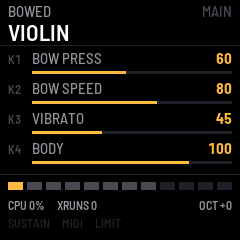

# fm1-violioliolol — FM-1 Physical Modelling Instrument

A physical-modelling string instrument for the M-VAVE FM-1. No samples: every
note is a vibrating string, computed in real time.



- **19 instruments in 4 families:** finger, pick, slap, fretless and upright
  bass; nylon, steel, clean, driven and jazz guitar; violin, viola, cello and
  contrabass; harp, mandolin, banjo, koto and zither.
- **Plucked strings:** extended Karplus–Strong waveguides with stiffness,
  pluck position, pickup position, buzz and five excitation styles.
- **Bowed strings:** a nonlinear stick-slip waveguide with bow pressure, speed
  and position, and vibrato.
- **Modal bodies** shared by all voices; tone, drive and a limiter on the way out.
- **Up to 12 voices**, a deterministic allocator with click-free stealing.
- **Performance:** velocity and pressure from the FM-1's keys; MIDI pitch
  bend, mod wheel, volume, expression, sustain, pressure, the knobs on
  CC16–23 and program change.
- **16 user presets** that store model parameters, never audio.

Read the [manual](app/docs/MANUAL.md) for the controls, or [try it in the browser](https://profikid.github.io/fm1-violioliolol/emu/).

## Status

Experimental. Everything in the [PRD](docs/PRD.md) is implemented and tested
on the host, and the firmware builds and passes fm1-base's checks with the
pinned JieLi toolchain. **Nothing is verified on a physical FM-1 yet**: CPU
load and polyphony on the device are unmeasured, so the default polyphony of
8 is a guess. If you install it, the [benchmark procedure](docs/benchmark-procedure.md)
is the most useful thing you can do with it.

## Install

Open the [web installer](https://profikid.github.io/fm1-violioliolol/install/) in Chrome or Edge with the FM-1
connected by USB, or download the `.fwsc` from the [latest release](https://github.com/profikid/fm1-violioliolol/releases/latest)
and use the Firmware Hub or `python3 tools/fm1_install.py` from fm1-base. The
packages are built from source on GitHub by the shared FM-1 builder and
carry a build attestation:

```sh
gh attestation verify fm1-violioliolol-VERSION.fwsc --repo profikid/fm1-violioliolol
```

This firmware does not touch the bootloader or the recovery path, and the stock
firmware can be reinstalled the usual way. The web installer also offers
m-bootloader, an open recovery bootloader, as a separate opt-in box.

## Releases

Every push to `main` is a release. `.github/workflows/version.yml` tags the commit with the next version and starts
the release on that tag, which builds the package on GitHub, attests it, publishes it, and rebuilds the site from it.

| To get | Do |
|---|---|
| a patch release, v0.1.1 → v0.1.2 | nothing: merge to `main` |
| a minor release, v0.1.2 → v0.2 | put `[minor]` in the PR title or a commit message |
| a major release, v0.2 → v1.0 | put `[major]` in the PR title or a commit message |
| no release | put `[skip release]` in the PR title or a commit message |
| a release of the current `main` | Actions → *Next version* → *Run workflow*, and pick patch, minor or major |

Release notes come from `docs/hub/notes_v<version>.md` if it exists, else for the first release of a minor line from
`docs/hub/notes_vXYY.md` (v0.2 → `notes_v002.md`), else GitHub's changelog since the previous release. Pushing a
version tag by hand still releases that commit.

## Build and test

```sh
git clone --recurse-submodules https://github.com/profikid/fm1-violioliolol.git
cd fm1-violioliolol
sh build.sh test                            # five native DSP suites + host throughput
sh build.sh --host && sh tests/scenarios/run.sh   # the whole firmware in fm1-base's simulator
sh build.sh                                 # FM-1 firmware: JieLi toolchain and AC79 SDK
```

The engine is in `dsp/` (platform-free C, see
[engineering-baseline.md](docs/engineering-baseline.md)); the FM-1 side is
`app/app.c`; the preset format is in [presets.md](docs/presets.md).

## Firmware base

Built on [fm1-base](https://github.com/charlesvestal/fm1-base) and
felucca-bsp, pinned as `base/` (fm1-base `f66ac4a`, felucca-bsp `d18879b`);
256-frame blocks at 44.1 kHz, the CPU at its stock 360 MHz.

## Project site

[profikid.github.io/fm1-violioliolol](https://profikid.github.io/fm1-violioliolol/): the front page, the web
installer, the firmware in the browser, the manual and the download. Each release builds it from its own attested
package with fm1-base's `tools/make_site.py`, styled by `tools/site_style.py` from `app/site/`.

MIT licence.
