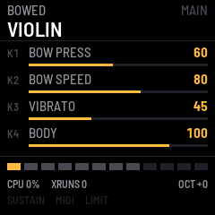
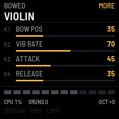
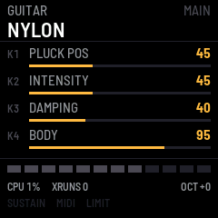
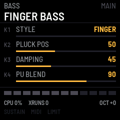
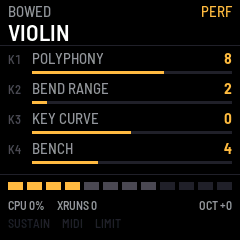

# fm1-violioliolol

fm1-violioliolol turns the M-VAVE FM-1 into a string instrument with no samples in it: every note is a vibrating
string, computed as it plays. There are nineteen instruments in four families (basses, guitars, bowed strings and
folk strings), two pages of four parameters each, and sixteen slots for your own.

**Experimental.** It is built and tested in fm1-base's simulator, but its CPU load on a real FM-1 has not been
measured yet, so the default of eight voices is a first guess. If you hear crackles, lower POLYPHONY (section 6).

---

## Contents

1. Install
2. The screen
3. Controls
4. Instruments
5. Saving
6. The PERF page
7. MIDI
8. Troubleshooting

---

## 1. Install

**Try it first:** the emulator on the site runs the same code in the browser, with sound, played with the mouse or
the computer's keyboard.

**Install:** open the install page in Chrome or Edge, connect the FM-1 by USB and press Install. Do not unplug the
FM-1 while it writes. If it runs M-VAVE's FM1 Open firmware, put M-VAVE's original firmware back first (M-VAVE's
workbench, *Restore original*), then install fm1-violioliolol.

**From a terminal:** download the `.fwsc` and run `python3 tools/fm1_install.py fm1-violioliolol-VERSION.fwsc` from
fm1-base's repository.

**Going back:** the installer can put M-VAVE's own firmware back. fm1-violioliolol itself never touches the FM-1's
bootloader; the installer offers m-bootloader, an open recovery bootloader, as a separate box you can tick.

## 2. The screen

- **Top:** the family (or USER and its slot), EDITED once you change
  something, the page (MAIN, MORE, PERF), and the instrument's name.
- **Four rows:** what K1 to K4 do now, the value and a bar.
- **Bottom:** a box per voice (bright: sounding, dim: free, dark: beyond the
  polyphony), CPU load of the audio render, xruns since power-on, the octave,
  and lights for SUSTAIN, MIDI in, LIMIT (the output limiter working) and SHED
  (voices dropped because the render ran out of time).

## 3. Controls

| Control | What it does |
|---|---|
| Keys | Play. Velocity and pressure are read from the keys; pressure goes where the instrument sends it (bow pressure on bowed strings, vibrato on plucked ones) |
| OCT− / OCT+ | Octave, −3 to +3, on top of the instrument's own range |
| ALGORITHM | Family: BASS, GUITAR, BOWED, FOLK, then USER once you have saved something |
| PRESET | The instrument within the family (or the next used USER slot) |
| SELECT | Every instrument end to end, factory then user |
| K1–K4 | The page's four parameters |
| EDIT | MAIN ↔ MORE: the instrument's second page of four |
| GLOBAL | PERF: polyphony, bend range, key curve, benchmark |
| PLAY | The sustain pedal, latched (lit while on) |
| SAVE | Save the instrument to a slot (below); on PERF, save the settings |
| HOME | All notes off, benchmark off, back to MAIN |

## 4. Instruments

| Family | Instruments | K1 to K4 on MAIN |
|---|---|---|
| BASS | FINGER BASS, PICK BASS, SLAP BASS, FRETLESS, UPRIGHT | Style, pluck position, damping, pickup blend (body on the upright) |
| GUITAR | NYLON, STEEL | Pluck position, intensity, damping, body |
| GUITAR | CLEAN ELEC, DRIVE ELEC, JAZZ | Pickup position, intensity, damping, drive |
| BOWED | VIOLIN, VIOLA, CELLO, CONTRABASS | Bow pressure, bow speed, vibrato, body |
| FOLK | HARP, MANDOLIN, BANJO, KOTO, ZITHER | Pluck position, intensity, damping, body |

 

MORE holds the rest: decay, stiffness, tone, release, buzz, bow position,
vibrato rate, attack. Mandolin plays a course of two strings a note, slightly
apart. Zither is struck with a hammer rather than plucked.

The parameters:

| Parameter | Plucked | Bowed |
|---|---|---|
| STYLE | Finger, pick, slap or hammer | — |
| PLUCK POS | Near the bridge (thin, bright) to the middle (round, hollow) | — |
| INTENSITY | How hard: the excitation's brightness | — |
| DAMPING | Loss of highs and of sustain | A darker bridge |
| BODY | How much of the sound goes through the body's resonances | Same |
| DECAY | How long a held note rings | — |
| STIFFNESS | Inharmonicity: the upper partials go sharp | — |
| RELEASE | How fast the string is damped when you let go | How fast the bow leaves the string |
| TONE | Output lowpass, as a guitar's tone control | Same |
| PICKUP POS / PU BLEND | Where a pickup sits, and how much of it you hear | — |
| DRIVE | Soft clipping | Same |
| BUZZ | The string rattling on frets or fingerboard | — |
| BOW PRESS / BOW SPEED / BOW POS | — | The bow's force, velocity and contact point |
| VIBRATO / VIB RATE | Pitch vibrato | Same, coming in after the attack |
| ATTACK | — | The bow reaching its speed |

## 5. Saving

1. Change what you like (SAVE lights up).
2. Press **SAVE**. The top line shows the slot it will go to: the slot the
   instrument came from, or the first free one. Turn PRESET (or SELECT or
   ALGORITHM) to pick another.
3. Press **SAVE** again to keep it. Any other button cancels.

The notes fade before the flash is written, which takes a moment. Your saved
instruments are in the USER family. On the PERF page, SAVE keeps the
polyphony, key curve, octave and the instrument you are on, so the FM-1 starts
there next time.

## 6. The PERF page

| Row | |
|---|---|
| POLYPHONY | 1 to 12 voices (default 8) |
| BEND RANGE | Pitch bend, 1 to 24 semitones each way (saved with the instrument) |
| KEY CURVE | The keys' velocity curve, −5 (soft) to +5 (hard) |
| BENCH | OFF, 1, 2, 4, 8 or 12 voices held and kept running, for measuring the CPU ([benchmark procedure](https://github.com/profikid/fm1-violioliolol/blob/main/docs/benchmark-procedure.md)) |

If the render ever takes more than 90 % of its time, one voice fades and the
polyphony drops by one (never below two); SHED counts how often.

## 7. MIDI

All channels are heard. The FM-1's own keys go out over USB on channel 1
(notes with velocity, and channel pressure).

| Message | Effect |
|---|---|
| Note on / off | Play, with velocity (velocity 0 is note-off) |
| Pitch bend | Glides the string, no retrigger; range per instrument |
| CC1 mod wheel | Raises the instrument's chosen parameter (vibrato on bowed strings) |
| CC7 volume, CC11 expression | Level; on bowed strings expression is also the bow's speed |
| CC16–CC19, CC20–CC23 | K1–K4 on MAIN, K1–K4 on MORE |
| CC64 | Sustain pedal |
| CC120, CC123, CC121 | All sound off, all notes off, reset controllers |
| Channel / poly pressure | The instrument's pressure destination |
| Program change N | The Nth instrument: 0–18 factory, 19–34 USER slots |

## 8. Troubleshooting

| What happens | What to do |
|---|---|
| Crackles or dropouts with many notes | Lower POLYPHONY on the PERF page. XRUNS on the status line counts dropouts; SHED lights when the firmware has already dropped a voice to keep up |
| A note is quieter than the others, or LIMIT lights | The limiter is holding a loud chord inside full scale. Turn the instrument's LEVEL, or CC7, down a little |
| A bowed note squeaks or whistles | Bow pressure too low for the speed: raise BOW PRESS, or lower BOW SPEED |
| A bowed note grinds | Too much pressure: lower BOW PRESS, or move BOW POS away from the bridge |
| Nothing from MIDI | Every channel is heard. Check the MIDI light on the status line; if it does not flash, the messages are not arriving |
| SAVE says FAILED | The flash write did not complete. Try again; the previous copy of your presets is kept |
| The USER family is missing | It appears once something is saved (section 5) |
| Something sounds wrong | Please open an issue with the instrument, what you played and, if you can, the benchmark numbers |
