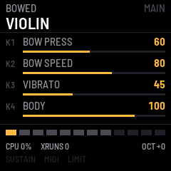

# fm1-violioliolol

fm1-violioliolol turns the M-VAVE FM-1 into a physical-modelling string instrument. There are no samples in it: every
note is a vibrating string, computed as it plays. Nineteen instruments in four families: finger, pick, slap, fretless
and upright bass; nylon, steel, clean, driven and jazz guitar; violin, viola, cello and contrabass; harp, mandolin,
banjo, koto and zither. Plucked strings are waveguides with stiffness, pluck and pickup position and fret buzz; bowed
strings are a stick-slip bow with pressure, speed, position and vibrato; each instrument has its own body. Up to
twelve voices, velocity and pressure from the keys, MIDI control, and sixteen slots for your own.

Version {{VERSION}}. **Experimental:** built and tested in the simulator, but not yet measured on a real FM-1, so
how many voices it can play there is still a guess. Installing is at your own risk; the installer can put M-VAVE's
own firmware back.

- [Try it in the browser](emu/) The same code the FM-1 runs, with sound. No FM-1 needed.
- [Install](install/) From Chrome or Edge, with the FM-1 connected by USB.
- [Manual](manual/) The instruments, the knobs, saving, the performance page, MIDI.
- [Download {{PKG}}](firmware/{{PKG}}) For the command-line installer, `python3 tools/fm1_install.py {{PKG}}`.
- [Help measure it](https://github.com/profikid/fm1-violioliolol/blob/main/docs/benchmark-procedure.md) The
  built-in benchmark, and what to report.

Built on fm1-base and felucca-bsp, from Felucca by Leo Kuroshita, Hügelton Instruments. MIT.
M-VAVE and FM-1 are trademarks of their owners. fm1-violioliolol is not affiliated with M-VAVE.
