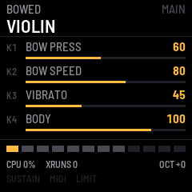

# fm1-violioliolol — manual

fm1-violioliolol turns the M-VAVE FM-1 into a string instrument with no samples
in it: every note is a vibrating string, computed as it plays. There are
nineteen instruments in four families, two pages of four parameters each, and
sixteen slots for your own.

## The screen

- **Top:** the family (or USER and its slot), EDITED once you change
  something, the page (MAIN, MORE, PERF), and the instrument's name.
- **Four rows:** what K1 to K4 do now, the value and a bar.
- **Bottom:** a box per voice (bright: sounding, dim: free, dark: beyond the
  polyphony), CPU load of the audio render, xruns since power-on, the octave,
  and lights for SUSTAIN, MIDI in, LIMIT (the output limiter working) and SHED
  (voices dropped because the render ran out of time).

## Controls

| Control | What it does |
|---|---|
| Keys | Play. Velocity and pressure are read from the keys; pressure goes where the instrument sends it (bow pressure on bowed strings, vibrato on plucked ones) |
| OCT− / OCT+ | Octave, −3 to +3, on top of the instrument's own range |
| ALGORITHM | Family: BASS, GUITAR, BOWED, FOLK, then USER once you have saved something |
| PRESET | The instrument within the family (or the next used USER slot) |
| SELECT | Every instrument end to end, factory then user |
| K1–K4 | The page's four parameters |
| EDIT | MAIN ↔ MORE: the instrument's second page of four |
| GLOBAL | PERF: polyphony, bend range, key curve, benchmark |
| PLAY | The sustain pedal, latched (lit while on) |
| SAVE | Save the instrument to a slot (below); on PERF, save the settings |
| HOME | All notes off, benchmark off, back to MAIN |

## Instruments

| Family | Instruments | K1 to K4 on MAIN |
|---|---|---|
| BASS | FINGER BASS, PICK BASS, SLAP BASS, FRETLESS, UPRIGHT | Style, pluck position, damping, pickup blend (body on the upright) |
| GUITAR | NYLON, STEEL | Pluck position, intensity, damping, body |
| GUITAR | CLEAN ELEC, DRIVE ELEC, JAZZ | Pickup position, intensity, damping, drive |
| BOWED | VIOLIN, VIOLA, CELLO, CONTRABASS | Bow pressure, bow speed, vibrato, body |
| FOLK | HARP, MANDOLIN, BANJO, KOTO, ZITHER | Pluck position, intensity, damping, body |

MORE holds the rest: decay, stiffness, tone, release, buzz, bow position,
vibrato rate, attack. Mandolin plays a course of two strings a note, slightly
apart. Zither is struck with a hammer rather than plucked.

The parameters:

| Parameter | Plucked | Bowed |
|---|---|---|
| STYLE | Finger, pick, slap or hammer | — |
| PLUCK POS | Near the bridge (thin, bright) to the middle (round, hollow) | — |
| INTENSITY | How hard: the excitation's brightness | — |
| DAMPING | Loss of highs and of sustain | A darker bridge |
| BODY | How much of the sound goes through the body's resonances | Same |
| DECAY | How long a held note rings | — |
| STIFFNESS | Inharmonicity: the upper partials go sharp | — |
| RELEASE | How fast the string is damped when you let go | How fast the bow leaves the string |
| TONE | Output lowpass, as a guitar's tone control | Same |
| PICKUP POS / PU BLEND | Where a pickup sits, and how much of it you hear | — |
| DRIVE | Soft clipping | Same |
| BUZZ | The string rattling on frets or fingerboard | — |
| BOW PRESS / BOW SPEED / BOW POS | — | The bow's force, velocity and contact point |
| VIBRATO / VIB RATE | Pitch vibrato | Same, coming in after the attack |
| ATTACK | — | The bow reaching its speed |

## Saving

1. Change what you like (SAVE lights up).
2. Press **SAVE**. The top line shows the slot it will go to: the slot the
   instrument came from, or the first free one. Turn PRESET (or SELECT or
   ALGORITHM) to pick another.
3. Press **SAVE** again to keep it. Any other button cancels.

The notes fade before the flash is written, which takes a moment. Your saved
instruments are in the USER family. On the PERF page, SAVE keeps the
polyphony, key curve, octave and the instrument you are on, so the FM-1 starts
there next time.

## The PERF page

| Row | |
|---|---|
| POLYPHONY | 1 to 12 voices (default 8) |
| BEND RANGE | Pitch bend, 1 to 24 semitones each way (saved with the instrument) |
| KEY CURVE | The keys' velocity curve, −5 (soft) to +5 (hard) |
| BENCH | OFF, 1, 2, 4, 8 or 12 voices held and kept running, for measuring the CPU ([benchmark-procedure.md](benchmark-procedure.md)) |

If the render ever takes more than 90 % of its time, one voice fades and the
polyphony drops by one (never below two); SHED counts how often.

## MIDI

All channels are heard. The FM-1's own keys go out over USB on channel 1
(notes with velocity, and channel pressure).

| Message | Effect |
|---|---|
| Note on / off | Play, with velocity (velocity 0 is note-off) |
| Pitch bend | Glides the string, no retrigger; range per instrument |
| CC1 mod wheel | Raises the instrument's chosen parameter (vibrato on bowed strings) |
| CC7 volume, CC11 expression | Level; on bowed strings expression is also the bow's speed |
| CC16–CC19, CC20–CC23 | K1–K4 on MAIN, K1–K4 on MORE |
| CC64 | Sustain pedal |
| CC120, CC123, CC121 | All sound off, all notes off, reset controllers |
| Channel / poly pressure | The instrument's pressure destination |
| Program change N | The Nth instrument: 0–18 factory, 19–34 USER slots |
